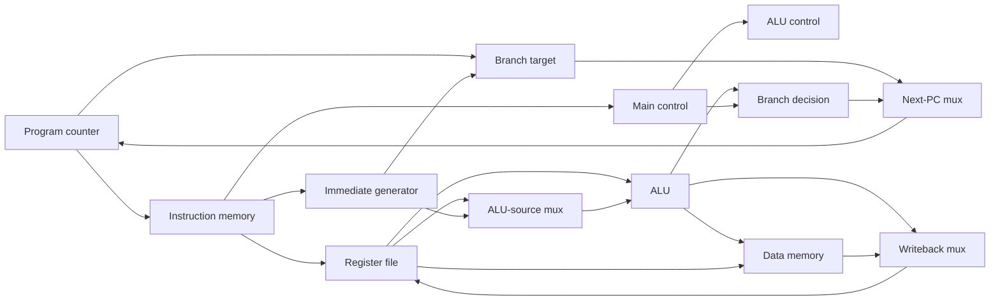

# Single-Cycle RV32I Processor

A modular 32-bit processor written in Verilog for the **Modern Computer Architecture** course. The core executes ten instructions from the RV32I base ISA and completes each supported instruction in one clock cycle. This repository contains the synthesizable RTL, self-checking testbenches, assembly workloads, instruction images, waveforms, generic synthesis results, an IEEE-format final report, and the final presentation.

The main demonstration computes **3 + 2 + 1**, stores the result **6** at byte address **64**, reloads it into **x4**, and uses the result in later branches. The recorded trace shows the loop returning twice, exiting when its counter reaches zero, writing RAM, and loading the same value back.

| Final result | Recorded evidence |
|---|---:|
| Supported instructions | 10 |
| Automated regression | 11 suites passed, 0 failed |
| Directed assembly workloads | 6 programs |
| Branch-program execution | 92 checked steps, 955 checks |
| Final whole-state test | 23 instruction steps |
| Generic synthesis | 22,531 cells, 9,248 flip-flops |

[Recorded submission report (PDF)](docs/final_project_report.pdf) · [Editable report (LaTeX)](docs/final_project_report.tex) · [Presentation](docs/final_presentation.pptx) · [Verification report](docs/verification_report.md) · [Recorded logs, traces and waveforms](docs/verification_evidence.zip)

## Contents

- [Project scope](#project-scope)
- [Processor architecture](#processor-architecture)
- [Supported instructions](#supported-instructions)
- [Quick start](#quick-start)
- [Verification](#verification)
- [Assembly programs](#assembly-programs)
- [Synthesis and performance](#synthesis-and-performance)
- [Repository structure](#repository-structure)
- [Team contributions](#team-contributions)
- [Limitations](#limitations)

## Project scope

The course specification asks for a compact single-cycle processor with a visible fetch–decode–execute datapath, modular synthesizable RTL, dedicated testbenches, instruction-memory programs, waveform evidence, resource utilization, a quantitative performance observation, and comparison with an alternative architecture. This repository implements that scope with separate instruction and data memories and a ten-instruction subset.

The implementation is intentionally small enough to trace by hand. It does not implement every RV32I instruction, exceptions, interrupts, privilege modes, CSRs, caches, or a pipeline. Unsupported encodings used by the final acceptance program advance the PC without changing architectural state.

## Quick start

From the repository root, run the following with Bash and Icarus Verilog (`iverilog` and `vvp`) on your path. On macOS with Homebrew, install the simulator with `brew install icarus-verilog`. The program images are included.

```bash
./run_tests.sh
```

A successful run ends with **`11 suites passed, 0 failed`**. Each suite writes a log under `build/regression/`. If a suite fails, the driver prints its log path, continues through the other suites, and returns a failing exit status. The reported submission run used Icarus Verilog 13.0.

| To inspect | Run or open | Evidence |
|---|---|---|
| Ten instructions on the integrated core | `bash scripts/run_phase2_integration.sh` | 20 checks of registers, memory and branch outcomes |
| Load/store behavior | `bash scripts/run_memory_integration.sh` | 34 checks covering addresses, data and writeback |
| ALU and comparisons | `bash scripts/run_alu_integration.sh` | 63 checks including signed boundaries and address arithmetic |
| Assembly execution and exact PC routes | `bash scripts/run_branch_integration.sh` | Six programs, 92 checked instruction steps, 955 checks |
| Whole-state acceptance | Run the regression and open `build/regression/final_cpu.log` | 23 steps, all 32 registers and every word of the 32-word test RAM, including seven unsupported instructions |

## Trace a program

Open [the mixed assembly program](programs/integration.S) beside `build/branch/integration.csv`. The PC is the byte address of the instruction being executed. The counter is x1, and the running sum is x2.

| At PC `0x14` | Counter | Sum | What BNE does |
|---|---:|---:|---|
| 71 ns | 2 | 3 | Returns to `0x0c` |
| 101 ns | 1 | 5 | Returns to `0x0c` |
| 131 ns | 0 | 6 | Advances to the store at `0x18` |

Open `build/branch/integration.vcd` in GTKWave or VaporView. Under `dut.u_core`, display `clk`, `pc`, `PCSrc`, `MemWrite`, `MemRead`, `alu_result`, `reg_data2` and `write_back_data`. The rising edge at **145 ns** writes six into RAM word 16. At **155 ns**, x4 captures the load result. The [branch guide](docs/phase2_branch_guide.md) gives the expected route for each program. The [waveform gallery](docs/waveforms/README.md) includes the independent store/load example using 25.

## Processor architecture

The complete Phase 2 core is [`rtl/rv32i_core.v`](rtl/rv32i_core.v). It integrates twelve reusable blocks. [`rtl/rv32i_top.v`](rtl/rv32i_top.v) wraps the core and exposes the current PC, instruction, and a completion signal used by program-level testbenches.



| Part | Design |
|---|---|
| Instruction subset | ADD, SUB, AND, OR, XOR, ADDI, LW, SW, BEQ, BNE |
| Phase 2 execution | [rv32i_core](rtl/rv32i_core.v) integrates 12 blocks. [rv32i_top](rtl/rv32i_top.v) exposes the PC, instruction and completion signal. |
| Storage | 32 registers of 32 bits with x0 fixed at zero. The core defaults to 22 instruction words and 256 data words. Memories use byte addresses. |
| State updates | Rising edges commit the PC and enabled writes. Word loads read RAM combinationally. Reset sets PC to zero and suppresses register and RAM writes. |
| Control flow | Sequential PC is PC + 4. A taken branch selects the branch instruction's PC plus its signed byte offset. Programs end with a self-branch observed by the wrapper. |
| Phase 1 baseline | The [arithmetic core](rtl/rv32i_phase1_core.v) and its original tests are retained. The final regression includes these earlier suites. |

The [integrated datapath diagram](docs/phase2_integration_guide.md) shows the connections. The [control table](docs/control_phase1_guide.md) identifies which signals change for each instruction. The [architecture comparison](docs/comparison.md) explains the trade-offs among single-cycle, multi-cycle and pipelined implementations.

## Supported instructions

| Instruction | Format | Architectural effect |
|---|---|---|
| `ADD rd, rs1, rs2` | R | `rd = rs1 + rs2` |
| `SUB rd, rs1, rs2` | R | `rd = rs1 - rs2` |
| `AND rd, rs1, rs2` | R | `rd = rs1 & rs2` |
| `OR rd, rs1, rs2` | R | `rd = rs1 \| rs2` |
| `XOR rd, rs1, rs2` | R | `rd = rs1 ^ rs2` |
| `ADDI rd, rs1, imm` | I | `rd = rs1 + sign_extend(imm)` |
| `LW rd, imm(rs1)` | I | `rd = memory[rs1 + sign_extend(imm)]` |
| `SW rs2, imm(rs1)` | S | `memory[rs1 + sign_extend(imm)] = rs2` |
| `BEQ rs1, rs2, target` | B | Select the target when the operands are equal |
| `BNE rs1, rs2, target` | B | Select the target when the operands differ |

## Verification

The verification strategy progresses from isolated modules to complete programs:

1. **Module tests** validate PC updates, storage behavior, ALU functions, immediate formats, control decoding, and multiplexers.
2. **Integrated instruction tests** check control signals and datapath results on the complete core.
3. **Assembly workloads** check exact PC routes, register state, memory state, forward branches, backward loops, and signed branch-offset limits.
4. **Whole-state acceptance** compares the PC, all 32 registers, and every word of a 32-word test RAM after each executed instruction.
5. **Fault injection** verifies that the tests detect a decoder which incorrectly accepts ORI as ADDI.

| Regression suite | Passing observation |
|---|---|
| `fetch` | Three benches for PC, instruction memory, and integrated fetch |
| `storage` | Register file and data-memory tests, including invalid accesses |
| `mux_immediate` | Immediate generator, ALU source, writeback, next-PC and branch-target tests |
| `alu` | 17 ALU cases and 14 ALU-control cases |
| `phase1` | 20 decoder cases, arithmetic-core execution, and depth-one memory boundaries |
| `full_cpu` | Earlier complete-core workload retained as a compatibility check |
| `integration` | 20 checks across all ten supported instructions |
| `memory` | 34 checks of loads, stores, offsets, read-after-write and skipped operations |
| `alu_integration` | 63 checks including wraparound, signed limits, addresses and branch comparisons |
| `branch` | Six programs, 92 executed steps and 955 route/control/state checks |
| `final_cpu` | 23 steps with full register/RAM comparison and seven unsupported encodings |

The fault-injection experiment changes a disposable copy of the decoder so that the ADDI path also accepts ORI. The final processor bench detects the forbidden register-write enable at PC `0x44`; the standalone decoder suite also fails. The unmodified RTL passes all eleven suites. Details are in the [verification report](docs/verification_report.md).

## Assembly programs

| Program | Purpose | Key expected result |
|---|---|---|
| [`arithmetic.S`](programs/arithmetic.S) | Arithmetic and logical operations | ADD = 30, SUB = 10, AND = 8, OR = 14, XOR = 6 |
| [`memory.S`](programs/memory.S) | Word stores and loads with signed offsets | Byte addresses 64 and 68 contain 25 and 50 |
| [`branch_equal.S`](programs/branch_equal.S) | Taken/fall-through BEQ and backward loop | Skipped writes remain zero |
| [`branch_not_equal.S`](programs/branch_not_equal.S) | Taken/fall-through BNE and backward loop | Loop terminates with its counter at zero |
| [`integration.S`](programs/integration.S) | All ten instruction types in one workload | `x4 = 6`, `x11 = 42`, skipped stores remain zero |
| [`branch_offsets.S`](programs/branch_offsets.S) | Aligned B-immediate limits | PC reaches targets at offsets `+4092` and `-4096` |

The committed images are sufficient for simulation. To reproduce them, install GNU RISC-V Binutils and run:

```bash
brew install riscv64-elf-binutils
bash scripts/build_branch_programs.sh --check
```

The builder uses RV32I with the ILP32 ABI, disables linker relaxation, links text at address zero, converts the extracted little-endian bytes into hexadecimal words, and compares every rebuilt image with its committed counterpart. Set `CROSS_COMPILE` if your tools use another prefix.

## Synthesis and performance

These workflows can be run independently of the simulation regression.

| Task | Command | Requirements and output |
|---|---|---|
| Verify the six checked-in assembly images | `bash scripts/build_branch_programs.sh --check` | GNU RISC-V Binutils and Python 3. Rebuilt images and disassemblies go to `build/branch_programs/`. Set `CROSS_COMPILE` for a custom tool prefix. |
| Check RTL modules | `bash scripts/check_phase1_rtl.sh` | Verilator and Yosys. Checks module lint, synthesis and structural properties. |
| Synthesize the integrated core | `./synthesize.sh` | Verilator, Yosys and Icarus Verilog. Refreshes the tracked [netlist](netlist/rv32i_core_netlist.v) and [raw synthesis report](synthesis_report.txt). |
| Rebuild the paper | `cd docs && latexmk -pdf final_project_report.tex` | A LaTeX installation with IEEEtran and the packages listed in the source. Tectonic can also compile the same file. |

| Generic synthesis result | Value |
|---|---:|
| Total cells | 22,531 |
| Enabled flip-flops | 9,216 |
| Resettable PC flip-flops | 32 |
| Multiplexers | 9,545 |
| ALU block depth | 69 generic logic levels |
| Branch-target block depth | 57 generic logic levels |

The single-cycle organization has a fixed **CPI of 1** for supported instructions. Its clock period must cover the slowest instruction. The load path includes register read, address addition, data-memory read, writeback selection, and register setup within the same cycle.

The documented **70–140 MHz range is an analytical estimate** calculated from assumed delay per generic logic level. It is not a measured device frequency. A valid FPGA or ASIC maximum frequency requires a target device or standard-cell library, clock constraints, mapped memories, placement, routing, and static timing analysis. See the [resource breakdown](docs/synthesis.md), [timing model](timing_analysis.md), and [single-cycle/multi-cycle/pipeline comparison](docs/comparison.md).

## Team contributions

| Member | Phase 1 | Phase 2 |
|---|---|---|
| Ankit | PC, instruction memory and fetch | Integrated core, wrapper and final datapath |
| Rashmi | Register file and data memory | Load/store integration, tests and waveforms |
| Ayush | ALU and ALU control | Integrated arithmetic and branch comparison, synthesis and timing |
| Samiksha | Main control and initial verification | Branch execution, PC routes and assembly programs (M13) |
| Saumya | Immediate generator, multiplexers and branch target | Whole-processor acceptance, automated regression and final documentation (M14/M16) |

The Phase 2 entries reflect the team’s agreed role exchange. Samiksha completed the M13 work originally allocated to Saumya, and Saumya completed the M14/M16 verification and documentation work originally allocated to Samiksha. The final demonstration is shared by the team.

## Repository structure

```text
RISC-V/
├── rtl/                    synthesizable processor modules
├── testbench/              self-checking Verilog testbenches
├── programs/               assembly sources and ROM images
├── scripts/                focused test and image-build runners
├── docs/                   reports, guides, figures and evidence
├── netlist/                generated generic core netlist
├── run_tests.sh            complete 11-suite regression
├── synthesize.sh           lint, simulation and synthesis flow
├── synthesis_report.txt    raw generic resource/path report
└── timing_analysis.md      critical-path interpretation
```

Important entry points:

- [`rtl/rv32i_core.v`](rtl/rv32i_core.v) — integrated processor implementation
- [`testbench/tb_final_verification.v`](testbench/tb_final_verification.v) — whole-state acceptance test
- [`programs/final_verification.hex`](programs/final_verification.hex) — annotated machine-code image used by that test
- [`docs/phase2_integration_guide.md`](docs/phase2_integration_guide.md) — module connections and integrated datapath
- [`docs/phase2_branch_guide.md`](docs/phase2_branch_guide.md) — PC routes and assembly evidence

## Limitations

- The core implements the ten instructions listed above, rather than the complete RV32I ISA.
- The tests are directed simulations. They do not constitute exhaustive formal proof of all instruction words and machine states.
- Register file and data memory use asynchronous reads. Generic synthesis maps their storage to flip-flops and selection logic instead of target-specific RAM macros.
- The wrapper completion signal is a testbench convenience based on a repeated PC. It is outside the processor ISA.
- The reported frequency range is a first-order estimate. No placed-and-routed FPGA or ASIC timing result is claimed.
- A multi-cycle or pipelined implementation would require new control state, intermediate registers, and hazard verification.

## Project documents

- [Recorded submission report](docs/final_project_report.pdf) and [editable IEEE LaTeX](docs/final_project_report.tex)
- [Final presentation](docs/final_presentation.pptx)
- [Verification methodology and demonstration sequence](docs/verification_report.md)
- [Architecture and control](docs/architecture.md)
- [Synthesis resource analysis](docs/synthesis.md)
- [Phase 1 IEEE report](docs/phase1-report.pdf) and [source](docs/phase1-report.tex)
- [Prototype video](https://drive.google.com/file/d/1h3wr6jaVHCT1d3m6KTbqFU8Jfo3WYwjh/view) and [project video folder](https://drive.google.com/drive/folders/1daOmAHnOrNh-L1YhrbRlE5GaWKV3XGjL?usp=sharing)

## Corrections after the recorded submission

The PDF, LaTeX, slides, waveform gallery and submission evidence archive record
the original submission. Current RTL uses the 22-word mixed program by default;
the regenerated netlist and synthesis_report.txt describe this corrected build.
See [correction status](docs/corrections.txt) for resolved audit findings and the
remaining target-specific timing requirement.

Run `python3 scripts/check_acceptance.py` after synthesis to check partial and
empty ROMs against synthesized implementations, default demo completion, the
committed core netlist trace, and rejection of incorrect SUB and completion timeout.
`./synthesize.sh` includes this check. GitHub Actions runs the regression, assembly
image check, lint, synthesis and acceptance checks on pushes and pull requests.

Instruction-memory capacity and image length are separate: `INIT_WORDS` on
`instruction_memory` gives the file's word count (default four for test_program.hex).
Core wrappers expose `IMEM_WORDS`, defaulting to `IMEM_DEPTH`. To put the mixed
program in a larger ROM, set `IMEM_DEPTH=64`, `IMEM_WORDS=22`, and
`IMEM_INIT_FILE="programs/integration.hex"`. Addresses beyond the loaded words
return NOP in both RTL and synthesis. Empty files use `IMEM_INIT_FILE=""`.
