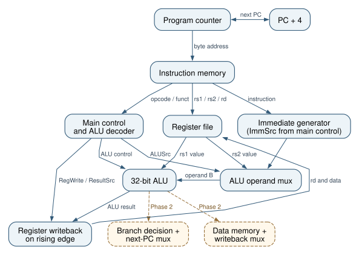
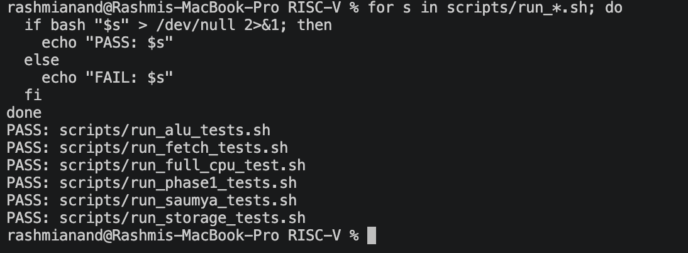
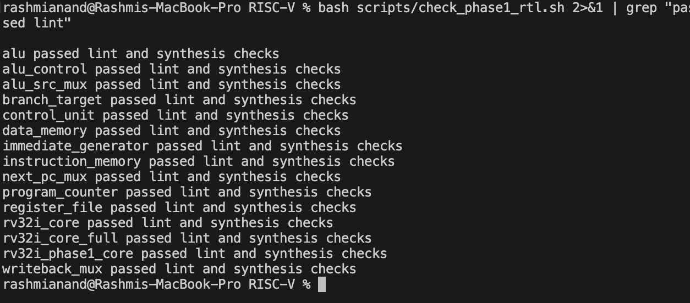
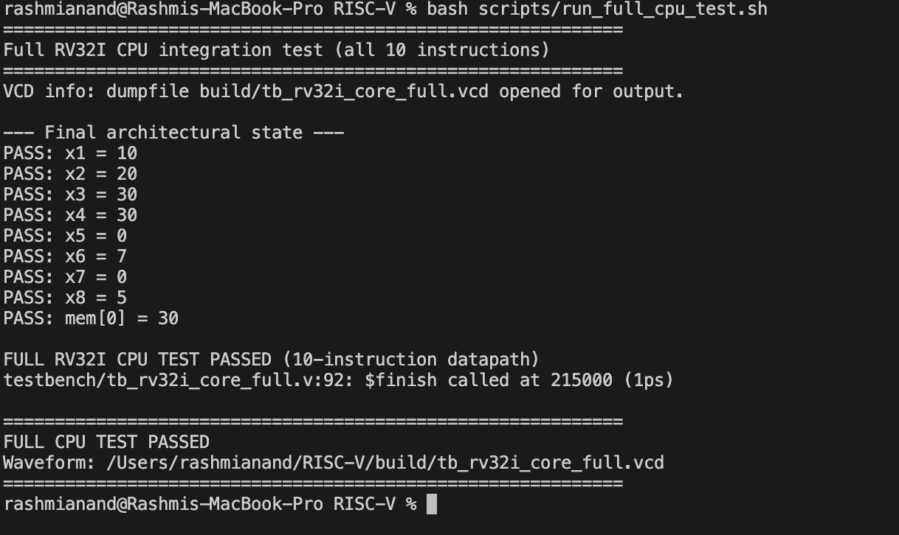

# Single-Cycle RISC-V Processor

**Modern Computer Architecture · Phase 2**

Phase 1 delivers a synthesizable 32-bit Verilog prototype that runs six RV32I
arithmetic and logic instructions. It includes standalone verification for the
storage and control-flow modules used in the next integration phase.

Phase 2 integrates the complete single-cycle datapath for `ADD`, `SUB`, `AND`,
`OR`, `XOR`, `ADDI`, `LW`, `SW`, `BEQ`, and `BNE`. Dedicated processor,
memory, ALU, and branch integration suites verify the full path, including signed
immediates, positive/negative memory offsets, branch equality decisions, and
32-bit arithmetic boundary cases.

[Phase 1 report (IEEE PDF)](docs/phase1-report.pdf) · [LaTeX source](docs/phase1-report.tex) ·
[Architecture](docs/architecture.md) · [Control truth table and waveforms](docs/control_phase1_guide.md)

## Final submission

Run `./run_tests.sh` to reproduce the eleven-suite processor regression. The verification report includes the team demonstration sequence and waveform signals.

[Project report (PDF)](docs/final_project_report.pdf) · [Presentation (PowerPoint)](docs/final_presentation.pptx) · [Verification report](docs/verification_report.md) · [Simulation evidence (ZIP)](docs/verification_evidence.zip)

## Prototype video

[Watch the 4:40 prototype demonstration](https://drive.google.com/file/d/1h3wr6jaVHCT1d3m6KTbqFU8Jfo3WYwjh/view) ·
[Public Google Drive folder](https://drive.google.com/drive/folders/1daOmAHnOrNh-L1YhrbRlE5GaWKV3XGjL?usp=sharing)

The video introduces the five team members and shows Verilog code, the datapath
diagram, simulation waveforms and the integrated CPU test.

## Run the prototype

Install Icarus Verilog. Verilator and Yosys run the RTL checks. Open the VCD
waveforms in [VaporView](https://marketplace.visualstudio.com/items?itemName=lramseyer.vaporview)
in VS Code.

```bash
brew install icarus-verilog verilator yosys
bash scripts/run_phase1_tests.sh
bash scripts/run_phase2_integration.sh
bash scripts/run_memory_integration.sh
bash scripts/run_alu_integration.sh
bash scripts/run_branch_integration.sh
./synthesize.sh
```

Run from the repository root. The script prints
`CONTROL UNIT TEST PASSED (20 cases)`, `PHASE 1 ARITHMETIC TEST PASSED`,
`ONE-WORD MEMORY TEST PASSED` and `PHASE 1 TESTS PASSED`.

The [demo image](programs/phase1_arithmetic.hex) begins with seven instructions
covering the six operations. The testbench checks the register writes at their
clock edges and verifies 14 instruction steps in total.

| PC | Instruction | Observed writeback (decimal) |
|---|---|---:|
| `0x00` | `addi x1, x0, 10` | x1 = 10 |
| `0x04` | `addi x2, x0, 20` | x2 = 20 |
| `0x08` | `add x3, x1, x2` | x3 = 30 |
| `0x0C` | `sub x4, x2, x1` | x4 = 10 |
| `0x10` | `and x5, x1, x2` | x5 = 0 |
| `0x14` | `or x6, x1, x2` | x6 = 30 |
| `0x18` | `xor x7, x1, x2` | x7 = 30 |

## Datapath and instruction scope



- [`rv32i_phase1_core.v`](rtl/rv32i_phase1_core.v) is the working arithmetic top level.
  It directly instantiates the program counter and instruction memory for its
  historical six-instruction regression. [`rv32i_core.v`](rtl/rv32i_core.v)
  is now the complete Phase 2 processor.
- `ADD`, `SUB`, `AND`, `OR`, `XOR` and `ADDI` execute end to end.
  Phase 2 also executes `LW`, `SW`, `BEQ` and `BNE` end to end.
- The register file contains 32 32-bit registers with x0 hardwired to zero.
  Instruction and data memories use byte addresses and asynchronous reads.
  The standalone memories default to 256 words. The prototype uses 14 instruction words.
  Reset sets the PC to zero and inhibits register writes.

## Phase 1 verification evidence

```bash
bash scripts/run_fetch_tests.sh &&
bash scripts/run_storage_tests.sh &&
bash scripts/run_alu_tests.sh &&
bash scripts/run_saumya_tests.sh &&
bash scripts/run_phase1_tests.sh &&
bash scripts/run_full_cpu_test.sh &&
bash scripts/check_phase1_rtl.sh
```



All six simulation suites passed, covering 16 testbenches. The RTL checker
runs Verilator `-Wall` and Yosys synthesis, latch and structural checks on all
15 modules, and every module passes with no inferred latches. Both memory
modules also passed Icarus elaboration and Verilator lint at depths 1, 2, 3, 14
and 256. The smallest configuration has a simulation regression for reads,
writes and address bounds.



The scripts generate VCDs under `build/`, including
`tb_control_unit.vcd`, `tb_rv32i_phase1_core.vcd` and
`tb_memory_depth_one.vcd`. The guide explains which signals to load.
The [Phase 1 waveform gallery](docs/waveforms/README.md) includes the
[integrated ADD writeback](docs/waveforms/tb_rv32i_phase1_core.jpg). The
[full-CPU waveform](docs/figures/full-cpu-waveform.png) shows the integration
test on the 10-instruction core. The demo executes ADDI, ADD, SW, LW, BEQ and BNE.
The single `MemWrite` pulse
is the `SW`, and the two `PCSrc` pulses are the taken `BEQ` and `BNE` branches
that skip over the `x5` and `x7` writes, matching the self-checked final state.


Running `bash scripts/run_full_cpu_test.sh` checks the expected final
register and memory values and reports `FULL RV32I CPU TEST PASSED`:



## Phase 2 branch execution and assembly programs

Samiksha implemented Saumya's M13 branch/PC and assembly-program work package.
The [M13 guide](docs/phase2_branch_guide.md) documents branch decisions,
expected PC routes, loop results and the handoff to Saumya for M14/M16.

```bash
bash scripts/run_branch_integration.sh
# Optional source rebuild and committed-image verification
brew install riscv64-elf-binutils
bash scripts/build_branch_programs.sh --check
```

The six programs cover arithmetic, load/store execution, BEQ, BNE, a mixed
ten-instruction workload and branch offsets of `+4092` and `-4096` bytes.
All six pass 955 checks across 92 instruction steps, including 25 functional
branch decisions. Logs, CSV execution traces and real VCD waveforms are
generated under `build/branch/`. Both skipped register writes and skipped
stores are checked. The [assembly sources](programs/) have matching GNU-built
hex images and reproducible disassemblies under `build/branch_programs/`.

All nine existing simulation runners and all 16 module lint/synthesis checks
also passed with M13 present. M14 complete-processor verification and M16
final documentation continue with Saumya under the team's role exchange.

## Synthesis

Generic Yosys synthesis of the full 10-instruction core (`rv32i_core`) reports
22,445 cells and 9,248 flip-flops (data memory 8,192, register file 1,024,
program counter 32), with no inferred latches. The single-cycle organisation
gives a fixed CPI of 1. Full resource tables are in
[docs/synthesis.md](docs/synthesis.md).

The synthesis workflow is [`synthesize.sh`](synthesize.sh). It runs
Verilator lint, the end-to-end ALU integration test, Yosys synthesis and
structural checks, creates
[`netlist/rv32i_core_netlist.v`](netlist/rv32i_core_netlist.v), and refreshes
[`synthesis_report.txt`](synthesis_report.txt). See
[`timing_analysis.md`](timing_analysis.md) for the load critical path, generic
logic-depth results, resource interpretation, and single-cycle timing limits.

**Timing / maximum operating frequency.** The `LW` critical path is ≈ 90 generic
gate levels (ALU-dominated), giving an estimated **Fmax ≈ 70–140 MHz** for a
generic standard-cell process; the derivation and the exact Vivado recipe for a
vendor-accurate number are in [docs/synthesis.md](docs/synthesis.md#timing-and-maximum-operating-frequency)
and [`timing_analysis.md`](timing_analysis.md#estimated-maximum-operating-frequency).

**Baseline comparison.** [docs/comparison.md](docs/comparison.md) compares this
single-cycle design (CPI = 1, long clock period) against multi-cycle and
pipelined alternatives for the same RV32I subset — CPI, clock period, throughput,
hazards and resource trade-offs.

## Team contributions

| Member | Phase 1 responsibility | Verification |
|---|---|---|
| Ankit | Program counter, instruction memory and fetch scaffold | [Fetch suite](docs/fetch_path_guide.md) |
| Rashmi | Register file and data memory | [Storage suite](docs/storage_guide.md) |
| Ayush | ALU and ALU control | [ALU suite](docs/alu_guide.md) |
| Saumya | Immediate generator, three multiplexers and branch target | [Operand selection suite](docs/saumya_modules.md) |
| Samiksha | Main control, arithmetic integration and processor verification | [Phase 1 control and arithmetic suite](docs/control_phase1_guide.md) |

RTL lives in `rtl/`, self-checking benches in `testbench/`, runners in
`scripts/`, program images in `programs/`, and submission evidence in `docs/`.
