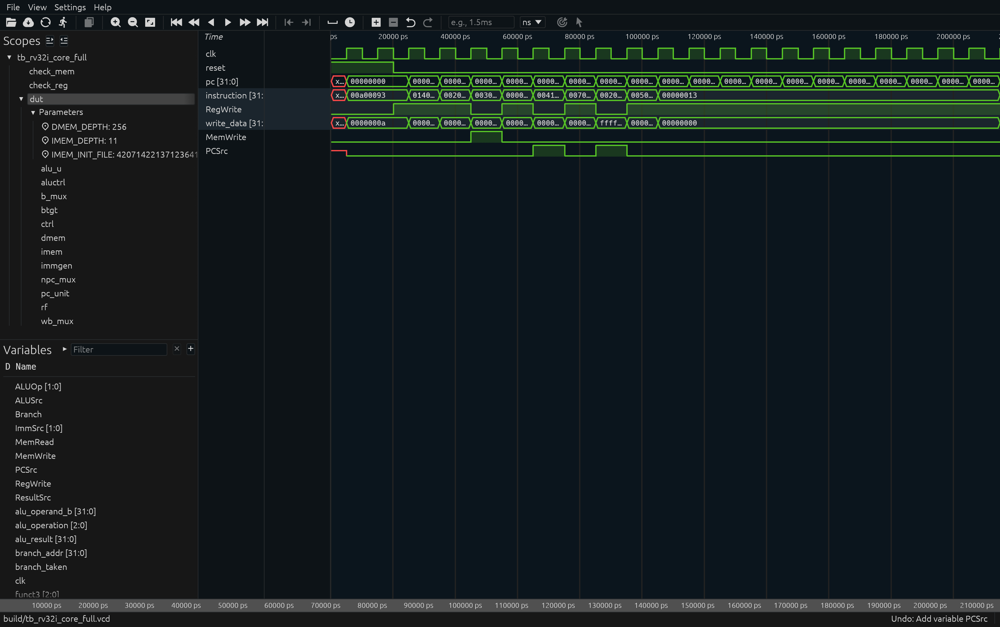

# Single-Cycle RISC-V Processor

**Modern Computer Architecture · Phase 1**

Phase 1 delivers a synthesizable 32-bit Verilog prototype that runs six RV32I
arithmetic and logic instructions. It includes standalone verification for the
storage and control-flow modules used in the next integration phase.

[Phase 1 report](docs/phase1-report.pdf) ·
[Architecture](docs/architecture.md) · [Control truth table and waveforms](docs/control_phase1_guide.md)

## Run the prototype

Install Icarus Verilog. Verilator and Yosys run the RTL checks. Open the VCD
waveforms in [VaporView](https://marketplace.visualstudio.com/items?itemName=lramseyer.vaporview)
in VS Code.

```bash
brew install icarus-verilog verilator yosys
bash scripts/run_phase1_tests.sh
```

Run from the repository root. The script prints
`CONTROL UNIT TEST PASSED (20 cases)`, `PHASE 1 ARITHMETIC TEST PASSED`,
`ONE-WORD MEMORY TEST PASSED` and `PHASE 1 TESTS PASSED`.

The [demo image](programs/phase1_arithmetic.hex) begins with seven instructions
covering the six operations. The testbench checks the register writes at their
clock edges and verifies 14 instruction steps in total.

| PC | Instruction | Observed writeback (decimal) |
|---|---|---:|
| `0x00` | `addi x1, x0, 10` | x1 = 10 |
| `0x04` | `addi x2, x0, 20` | x2 = 20 |
| `0x08` | `add x3, x1, x2` | x3 = 30 |
| `0x0C` | `sub x4, x2, x1` | x4 = 10 |
| `0x10` | `and x5, x1, x2` | x5 = 0 |
| `0x14` | `or x6, x1, x2` | x6 = 30 |
| `0x18` | `xor x7, x1, x2` | x7 = 30 |

## Datapath and instruction scope


- [`rv32i_phase1_core.v`](rtl/rv32i_phase1_core.v) is the working arithmetic top level.
  It wraps the sequential [fetch stage](rtl/rv32i_core.v), which contains the
  program counter, instruction memory and PC + 4.
- `ADD`, `SUB`, `AND`, `OR`, `XOR` and `ADDI` execute end to end.
  `LW`, `SW`, `BEQ` and `BNE` are decoded and covered by the control-unit test.
  Phase 2 connects the data memory and branch path to execute those instructions.
- The register file contains 32 32-bit registers with x0 hardwired to zero.
  Instruction and data memories use byte addresses and asynchronous reads.
  The standalone memories default to 256 words. The prototype uses 14 instruction words.
  Reset sets the PC to zero and inhibits register writes.

## Verification

```bash
bash scripts/run_fetch_tests.sh &&
bash scripts/run_storage_tests.sh &&
bash scripts/run_alu_tests.sh &&
bash scripts/run_saumya_tests.sh &&
bash scripts/run_phase1_tests.sh &&
bash scripts/run_full_cpu_test.sh &&
bash scripts/check_phase1_rtl.sh
```


All six simulation suites passed, covering 15 testbenches. The RTL checker
runs Verilator `-Wall` and Yosys synthesis, latch and structural checks on all
15 modules, and every module passes with no inferred latches. Both memory
modules also passed Icarus elaboration and Verilator lint at depths 1, 2, 3, 14
and 256. The smallest configuration has a simulation regression for reads,
writes and address bounds.


The scripts generate VCDs under `build/`, including
`tb_control_unit.vcd`, `tb_rv32i_phase1_core.vcd` and
`tb_memory_depth_one.vcd`. The guide explains which signals to load.
The [arithmetic waveform](docs/phase1_arithmetic_waveform.png) captures the
first seven instructions from simulation. The
[full-CPU waveform](docs/figures/full-cpu-waveform.png) captures the complete
10-instruction datapath (`tb_rv32i_core_full.vcd`): the single `MemWrite` pulse
is the `SW`, and the two `PCSrc` pulses are the taken `BEQ` and `BNE` branches
that skip over the `x5` and `x7` writes, matching the self-checked final state.



Running `bash scripts/run_full_cpu_test.sh` self-checks every architectural
result and reports `FULL RV32I CPU TEST PASSED`:


## Synthesis

Generic Yosys synthesis of the full 10-instruction core (`rv32i_core_full`)
reports 22374 cells and 9248 flip-flops (data memory 8192, register file 1024,
program counter 32), with no inferred latches. The single-cycle organisation
gives a fixed CPI of 1. Full resource tables are in
[docs/synthesis.md](docs/synthesis.md).

## Team contributions

| Member | Phase 1 responsibility | Verification |
|---|---|---|
| Ankit | Program counter, instruction memory and fetch scaffold | [Fetch suite](docs/fetch_path_guide.md) |
| Rashmi | Register file and data memory | [Storage suite](docs/storage_guide.md) |
| Ayush | ALU and ALU control | [ALU suite](docs/alu_guide.md) |
| Saumya | Immediate generator, three multiplexers and branch target | [Operand selection suite](docs/saumya_modules.md) |
| Samiksha | Main control, arithmetic integration and processor verification | [Phase 1 control and arithmetic suite](docs/control_phase1_guide.md) |

RTL lives in `rtl/`, self-checking benches in `testbench/`, runners in
`scripts/`, program images in `programs/`, and submission evidence in `docs/`.
