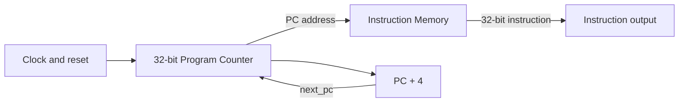

# Phase 1 Fetch-Path Architecture

This Phase 1 implementation contains the instruction-fetch portion of the RV32I processor only.

## Operation

1. On a rising clock edge, the Program Counter stores `next_pc`.
2. When reset is asserted, the Program Counter synchronously loads `0x00000000`.
3. The current PC is supplied to Instruction Memory as a byte address.
4. Instruction Memory returns the 32-bit word at `address[31:2]` using a combinational read.
5. The Phase 1 core calculates `PC + 4`, so the next sequential instruction is fetched on the next rising edge.

## Design decisions

- PC width: 32 bits.
- Instruction width: 32 bits.
- Reset: synchronous, active-high; reset PC is zero.
- Instruction addressing: byte-addressed, with 4-byte instruction alignment.
- Instruction read: combinational/asynchronous.
- Program initialization: `$readmemh`.
- Unused, misaligned, or out-of-range instruction addresses return `ADDI x0, x0, 0` (`32'h00000013`, the RISC-V NOP encoding).

## Integration note

`rv32i_core.v` is intentionally a fetch-path scaffold for Phase 1, not a complete processor. In the final integrated core, the `pc_plus4` path will be replaced by next-PC selection logic that can choose sequential, branch, or jump targets. The reset polarity/timing and module port names should be reconciled with the team's final interface contract before merging.
