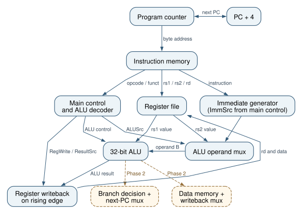

# Phase 1 architecture

The runnable prototype is [rv32i_phase1_core](../rtl/rv32i_phase1_core.v). It
uses [rv32i_core](../rtl/rv32i_core.v) as the instruction-fetch stage. The
fetch stage has its own tests for the program counter and instruction memory.
The integrated prototype adds decode, execution and register writeback.

Solid blocks and connections show the working arithmetic path. Dashed blocks
show where memory writeback and branch selection enter the design in Phase 2.

1. The rising clock edge updates the 32-bit, byte-addressed PC. Active-high
   synchronous reset selects address zero. Normal operation selects PC + 4.
2. Instruction memory returns a 32-bit word using an asynchronous read.
   Misaligned and out-of-range fetches return the canonical NOP, `00000013`.
3. The instruction selects two register operands and a destination. The control
   unit validates the opcode and function fields. The immediate generator
   sign-extends I-, S- or B-type immediates and the ALU operand mux selects
   the second register operand or the immediate.
4. The ALU computes the result combinationally. The destination updates on the
   rising edge when reset is low, `RegWrite` is high and `ResultSrc` selects
   the ALU. Register x0 always reads zero and discards writes.

## Integration status

| Block | Phase 1 status |
|---|---|
| Program counter and instruction memory | Integrated and tested |
| Main control, register file, immediate generator, ALU source mux, ALU decoder and ALU | Integrated for the six arithmetic instructions |
| Data memory and writeback mux | Implemented and individually tested. Wire them into the core in Phase 2 |
| Branch target and next-PC mux | Implemented and individually tested. Connect the branch condition and PC selection in Phase 2 |

The prototype loads the 14-word demo image. The fetch scaffold and data memory
default to 256 words. The one-word memory regression verifies the minimum
supported depth with valid, misaligned and out-of-range addresses.

See the [control truth table and waveform guide](control_phase1_guide.md) for
the decoder outputs, simulation commands and expected results.
