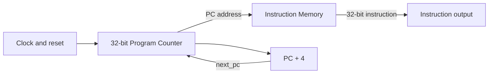
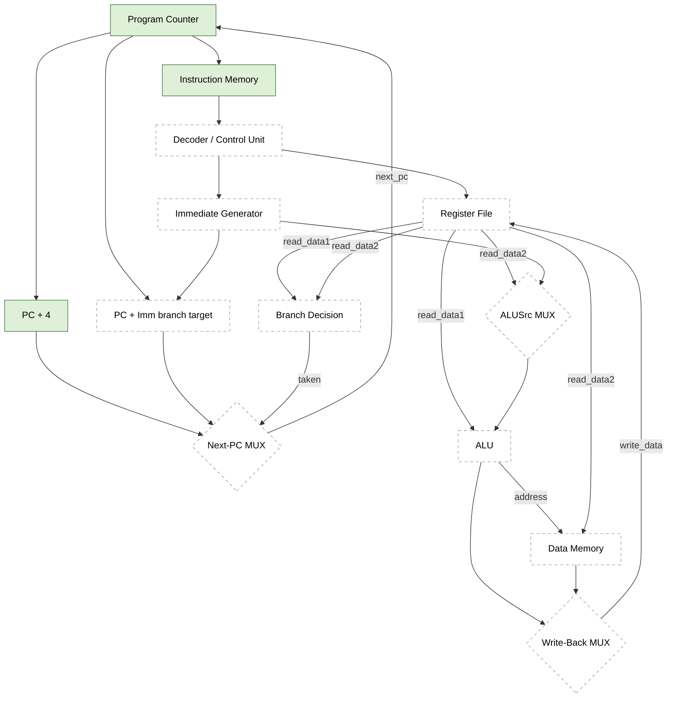

# Phase 1 Fetch-Path Architecture

The integrated `rv32i_core.v` currently contains the instruction-fetch portion
of the RV32I processor. The register file, data memory, ALU, and ALU control
are individually implemented and tested, but are not yet wired into this core.

## Operation

1. On a rising clock edge, the Program Counter stores `next_pc`.
2. When reset is asserted, the Program Counter synchronously loads `0x00000000`.
3. The current PC is supplied to Instruction Memory as a byte address.
4. Instruction Memory returns the 32-bit word at `address[31:2]` using a combinational read.
5. The Phase 1 core calculates `PC + 4`, so the next sequential instruction is fetched on the next rising edge.

## Design decisions

- PC width: 32 bits.
- Instruction width: 32 bits.
- Reset: synchronous, active-high; reset PC is zero.
- Instruction addressing: byte-addressed, with 4-byte instruction alignment.
- Instruction read: combinational/asynchronous.
- Program initialization: `$readmemh`.
- Unused, misaligned, or out-of-range instruction addresses return `ADDI x0, x0, 0` (`32'h00000013`, the RISC-V NOP encoding).

## Complete single-cycle RV32I datapath (architecture target)

The diagram below shows the full single-cycle datapath the processor is being built
toward. Solid PC, PC+4, and instruction-memory blocks are wired into the current
core. The register file, ALU, and data memory are implemented separately but
still need integration. The remaining dashed blocks are planned.

| Block | Phase | Owner / status |
|---|---|---|
| Program Counter | 1 | Implemented |
| PC + 4 | 1 | Implemented (in `rv32i_core.v`) |
| Instruction Memory | 1 | Implemented |
| Decoder / Control Unit | 2 | Planned |
| Register File | 1 | Implemented separately; integration pending |
| Immediate Generator | 2 | Planned |
| ALUSrc MUX | 2 | Planned |
| ALU and ALU control | 1 | Implemented separately; integration pending |
| Branch Decision | 2 | Planned |
| Data Memory | 1 | Implemented separately; integration pending |
| Write-Back MUX | 2 | Planned |
| Next-PC MUX / branch target | 2 | Planned (replaces the Phase 1 `pc_plus4` path) |

## Integration note

`rv32i_core.v` is intentionally a fetch-path scaffold for Phase 1, not a complete processor. In the final integrated core, the `pc_plus4` path will be replaced by next-PC selection logic that can choose sequential, branch, or jump targets. The reset polarity/timing and module port names should be reconciled with the team's final interface contract before merging.
