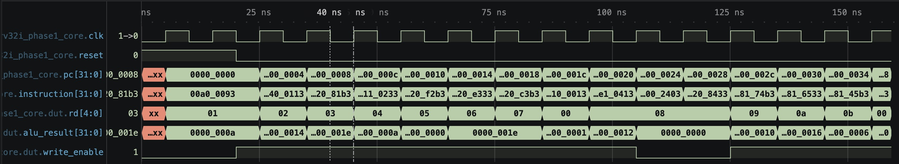

# Phase 1 control and arithmetic verification

The [control unit](../rtl/control_unit.v) decodes the ten instructions in the
project's RV32I subset. The [Phase 1 core](../rtl/rv32i_phase1_core.v) reuses
the sequential fetch path and connects the register file, immediate generator,
ALU operand mux, and ALU to execute six arithmetic and logic instructions.
Load, store, and branch signals are verified in the decoder testbench. Data
memory writeback, stores, and branch execution are Phase 2 integration work.

## Control truth table

Opcode, funct3, and funct7 values are binary. A dash marks a field the control
unit does not use for that instruction.

| Instruction | Opcode | funct3 | funct7 | RegWrite | ALUSrc | MemRead | MemWrite | ResultSrc | Branch | ALUOp | ImmSrc |
|---|---|---|---|---:|---:|---:|---:|---:|---:|---|---|
| ADD | 0110011 | 000 | 0000000 | 1 | 0 | 0 | 0 | 0 | 0 | 10 | 11 |
| SUB | 0110011 | 000 | 0100000 | 1 | 0 | 0 | 0 | 0 | 0 | 10 | 11 |
| AND | 0110011 | 111 | 0000000 | 1 | 0 | 0 | 0 | 0 | 0 | 10 | 11 |
| OR | 0110011 | 110 | 0000000 | 1 | 0 | 0 | 0 | 0 | 0 | 10 | 11 |
| XOR | 0110011 | 100 | 0000000 | 1 | 0 | 0 | 0 | 0 | 0 | 10 | 11 |
| ADDI | 0010011 | 000 | — | 1 | 1 | 0 | 0 | 0 | 0 | 00 | 00 |
| LW | 0000011 | 010 | — | 1 | 1 | 1 | 0 | 1 | 0 | 00 | 00 |
| SW | 0100011 | 010 | — | 0 | 1 | 0 | 1 | 0 | 0 | 00 | 01 |
| BEQ | 1100011 | 000 | — | 0 | 0 | 0 | 0 | 0 | 1 | 01 | 10 |
| BNE | 1100011 | 001 | — | 0 | 0 | 0 | 0 | 0 | 1 | 01 | 10 |
| Unsupported encoding | Other combinations | — | — | 0 | 0 | 0 | 0 | 0 | 0 | 11 | 11 |

- `ALUSrc` selects the second register operand at 0 and the immediate at 1.
  `ResultSrc` selects the ALU result at 0 and memory data at 1 for writeback.
- `ALUOp` feeds the [ALU decoder](alu_guide.md). Codes `00`, `01`, `10`, and
  `11` select addition, subtraction for branch comparison, R-type function
  decoding, and the unsupported operation respectively.
- `ImmSrc` selects I-type (`00`), S-type (`01`), B-type (`10`), or a zero
  immediate (`11`). The [immediate generator](saumya_modules.md) sign-extends
  the selected field.
- `Branch` identifies a supported branch instruction. The branch condition uses
  `funct3` and the ALU zero flag when branch execution is integrated.
- The Phase 1 register write enable requires reset to be low, `RegWrite` to be
  high, and `ResultSrc` to select the ALU. The register file ignores writes to x0.

## Run the tests

From the repository root with Icarus Verilog installed:

```bash
bash scripts/run_phase1_tests.sh
```

The testbenches stop with a nonzero exit on a mismatch. A successful run prints
`CONTROL UNIT TEST PASSED (20 cases)`, `PHASE 1 ARITHMETIC TEST PASSED`, `ONE-WORD MEMORY TEST PASSED`, and
`PHASE 1 TESTS PASSED`.

The [demo program](../programs/phase1_arithmetic.hex) starts with the seven
instructions below. The processor testbench checks the destination and
writeback after each instruction.

| PC | Instruction | Observed register value |
|---|---|---|
| `0x00` | `addi x1, x0, 10` | x1 = 10 |
| `0x04` | `addi x2, x0, 20` | x2 = 20 |
| `0x08` | `add x3, x1, x2` | x3 = 30 |
| `0x0C` | `sub x4, x2, x1` | x4 = 10 |
| `0x10` | `and x5, x1, x2` | x5 = 0 |
| `0x14` | `or x6, x1, x2` | x6 = 30 |
| `0x18` | `xor x7, x1, x2` | x7 = 30 |

The remaining seven instructions check x0 protection, negative immediate
writeback, disabled memory writeback for LW, an unsupported MUL encoding, and
AND, OR, and XOR with overlapping operands. The testbench also checks reset,
PC progression, and the NOP fetched beyond the program.

All five simulation suites passed. Run `bash scripts/check_phase1_rtl.sh`
to reproduce strict Verilator lint and Yosys synthesis, latch and structural
checks for all 14 RTL modules. The Phase 1 runner also tests one-word memory
read, write and address bounds.

## View the waveforms

Open the generated VCD files in VS Code with
[VaporView](https://marketplace.visualstudio.com/items?itemName=lramseyer.vaporview).
Select the VaporView icon in the activity bar, expand the scope, and
double-click a signal in the netlist to add it.

| File | Signals to add |
|---|---|
| `build/tb_control_unit.vcd` | In `tb_control_unit`, add `instruction`, `RegWrite`, `ALUSrc`, `MemRead`, `MemWrite`, `ResultSrc`, `Branch`, `ALUOp`, and `ImmSrc` |
| `build/tb_rv32i_phase1_core.vcd` | In `tb_rv32i_phase1_core`, add `clk`, `reset`, `pc`, and `instruction`. In its `dut` scope, add `rd`, `alu_result`, and `write_enable` |

The screenshot below comes directly from VaporView. At 40 ns the ADD at
PC `0x08` presents destination `x3` and result `0x1E` with write enable
asserted. The register file commits that result at the 45 ns rising edge,
which also advances the PC to the next instruction (SUB). The simulation
checks `x3 = 30` after the edge.



See the [waveform gallery](waveforms/README.md) for all 15 testbenches,
including the [control unit trace](waveforms/tb_control_unit.jpg).
