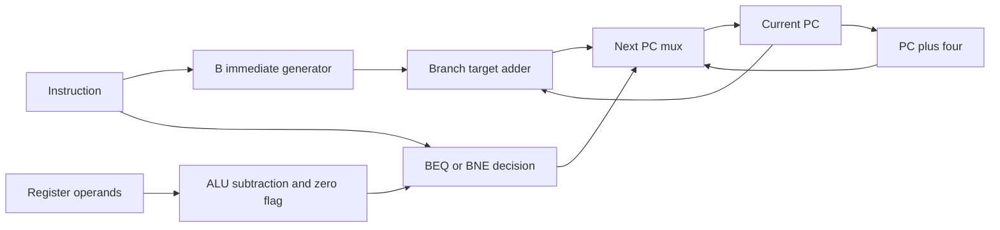

# Phase 2 branch execution and assembly programs

Samiksha Jangid implemented Saumya's M13 work package under the team's agreed
role exchange. M13 covers BEQ/BNE execution, branch targets, next-PC control
and executable assembly workloads. The assignment follows the shared
[Phase 2 work distribution](https://chatgpt.com/s/t_6afded948c348191a13b56dd7261b2ac).

The starting revision was `6bc3cad`, with Ankit's integrated processor,
Rashmi's memory suite and Ayush's ALU and synthesis work already merged.
The branch datapath in that revision passed the new directed cases, so the
existing RTL behavior is retained. The wrapper comments now describe its
completion flag accurately.

## Branch datapath



The B immediate already includes its low zero bit. `branch_target.v` adds
that signed byte offset directly to the branch instruction's current PC.
`rv32i_core.v` selects the target when `Branch & (funct3[0] ? ~zero : zero)`
is asserted. `next_pc_mux.v` selects `PC + 4` for fall-through execution.

| Decision | Equality result | PCSrc | Next PC |
|---|---|---:|---|
| BEQ taken | Equal | 1 | Current PC plus signed offset |
| BEQ fall-through | Different | 0 | Current PC plus four |
| BNE taken | Different | 1 | Current PC plus signed offset |
| BNE fall-through | Equal | 0 | Current PC plus four |

All workload targets are four-byte aligned. The directed boundary program
tests a forward offset of `+4092`, the largest positive B offset compatible
with this core's four-byte instruction alignment, and the minimum B offset
of `-4096`. Its 1028-word ROM includes explicit NOP padding between code
regions. The other workloads use much smaller instruction memories.

## Reproduce the assembly images

The six `.S` sources use the ten supported instructions and a terminal
`beq x0, x0, done` at label `done`. GNU assembly uses RV32I, the ILP32 ABI,
disabled relaxation and a text address of zero. The builder extracts `.text`
and converts each little-endian group of four bytes into one eight-digit
instruction word for `$readmemh`.

```bash
brew install riscv64-elf-binutils
bash scripts/build_branch_programs.sh
bash scripts/build_branch_programs.sh --check
```

The verified tool was GNU Binutils `2.47.20260726`. `CROSS_COMPILE` can select
another GNU RISC-V prefix, such as `riscv64-unknown-elf-`. Python 3 performs
the byte-to-word conversion. ELF files, flat binaries and disassemblies are
written under `build/branch_programs/`. The `--check` command compares every
rebuilt image with its committed `.hex` file and fails on a mismatch.

Simulation can use the committed images with Icarus Verilog alone.

```bash
bash scripts/run_branch_integration.sh
```

Both scripts resolve paths from their own location and also work when invoked
by absolute path from another directory.

## Programs and observed results

| Program source and matching hex | ROM words | Checked steps | Checks | Completion PC |
|---|---:|---:|---:|---|
| `programs/arithmetic.S` | 15 | 15 | 137 | `0x0038` |
| `programs/memory.S` | 11 | 11 | 121 | `0x0028` |
| `programs/branch_equal.S` | 16 | 18 | 194 | `0x003c` |
| `programs/branch_not_equal.S` | 13 | 15 | 167 | `0x0030` |
| `programs/integration.S` | 22 | 24 | 203 | `0x0054` |
| `programs/branch_offsets.S` | 1028 | 9 | 133 | `0x100c` |
| Total | | 92 | 955 | |

Each step checks one executed instruction, including one terminal self-branch.
Reset and two additional terminal observation cycles are outside this step
count. The checks column includes PC/control assertions and final state checks.
Each program runs in an independent simulation using `rv32i_top`, with its
own instruction image and 32-word data memory.

The existing register-file and data-memory simulation models initialize their
arrays to zero. Expected values for untouched registers and skipped stores
use that initial state. Reset sets the PC and suppresses writes, while the
arrays retain their current contents during reset.

| Program | Expected result |
|---|---|
| Arithmetic | ADD=30, SUB=10; overlapping operands 12 and 10 produce AND=8, OR=14 and XOR=6; `-1 + 1` produces zero. |
| Memory | Byte addresses 64 and 68 contain 25 and 50. Loads using positive and negative offsets return those values. |
| BEQ | x1=x2=10, x4=20, loop counter x5=0 and x6=7. Skipped x3 and memory byte addresses 0 and 4 remain zero. |
| BNE | x1=10, x2=20, x4=30, loop counter x5=0 and x6=7. Skipped x3 and memory byte address 0 remain zero. |
| Mixed integration | A backward loop computes 3+2+1=6 and stores/reloads it at byte address 64. x10=1 and x11=42. Skipped stores leave byte addresses 68 and 72 at zero. All ten supported instruction types execute. |
| Offset boundaries | PC visits `0x0004 -> 0x1000 -> 0x1004 -> 0x0004`; the second pass exits with x1=0, x2=0 and x3=7. |

## Directed verification

`testbench/tb_branch_integration.v` contains independently authored expected
PC routes and signed branch offsets for all six programs. It checks the
selected next PC before the edge and the committed PC after the edge.
For branches it also checks B-immediate extraction, target addition, the ALU
zero flag, PCSrc and disabled register/memory writes. Final checks compare
all 32 registers and all 32 data-memory words with each program's expected
state, after nonblocking writes have settled.

The cases include taken and fall-through BEQ/BNE decisions, forward skips,
negative offsets, a terminating backward loop, a false branch to its own PC,
and a taken branch with offset `+4`. The last case checks PCSrc explicitly
because its destination also equals the sequential address.

| Functional branch coverage | Taken | Fall-through |
|---|---:|---:|
| BEQ | 9 | 4 |
| BNE | 7 | 5 |
| Total | 16 | 9 |

These 25 decisions exclude every terminal completion branch. A simulated
10 ns clock drives the functional tests. Its period is a testbench setting.

The terminal self-branch continues executing while the wrapper observes the
repeated PC and raises `halted`. Ordinary NOPs keep advancing PC by four.
The bench checks its expected completion address and has a 10 microsecond
watchdog. `$fatal(1)`, `set -euo pipefail` and a required PASS marker propagate
failures through the runner.

Local fault-injection checks rejected five altered designs covering a wrong
PC-relative base, an inverted next-PC mux, an unsigned backward offset, an
inverted equality decision and a lost taken signal for offset `+4`.
Additional runner checks rejected a simulator failure, missing PASS output
and an assembly/hex mismatch. All injected changes stayed in disposable
files under `build/m13-validation/`.

## Inspect real simulation evidence

The runner writes each program's simulator log, CSV execution trace and raw
VCD waveform under `build/branch/`. Open `branch_equal.vcd`,
`branch_not_equal.vcd`, `integration.vcd` or `branch_offsets.vcd` in VaporView.
Add `clk`, `reset`, `pc`, `instruction` and `halted`, then the core signals
`Branch`, `zero`, `PCSrc`, `imm_ext`, `branch_addr` and `next_pc_wire`.

In `branch_equal.csv`, the branch at PC `0x2c` selects `0x24` twice, then
the branch at PC `0x28` selects `0x34` when x5 becomes zero. In
`branch_not_equal.csv`, PC `0x24` returns to `0x20` twice and falls through
to `0x28` on the final iteration. The CSV values come directly from the
same DUT that produced the VCD.

## Compatibility checks and next handoff

All nine pre-existing simulation runners passed again after M13 was added.
The M13 runner adds six passing program configurations. The existing RTL
checker passed Verilator `-Wall`, Yosys synthesis, latch and structural
checks for all 16 RTL modules.

Saumya will continue with Samiksha's assigned M14 complete-processor
verification and global regression, followed by M16 final report and
presentation work. She can reuse these six assembly images, their expected
states, PC routes and raw traces for that work. The existing
`timing_analysis.md` describes generic synthesis and logic depth; a measured
device-specific maximum frequency remains a hardware-target follow-up.
