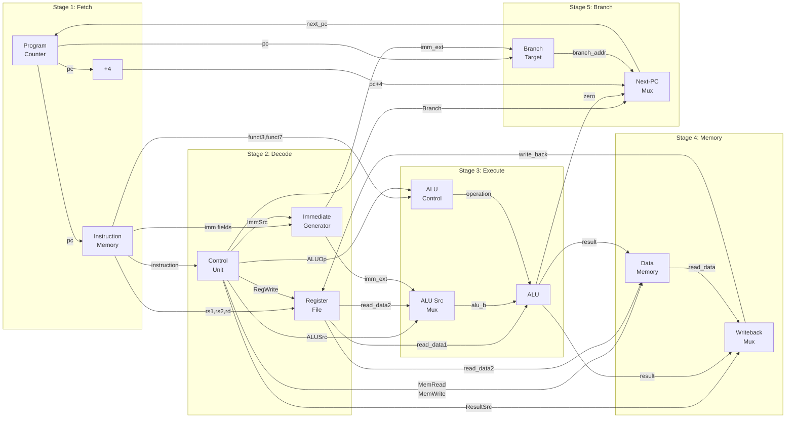

# Phase 2 — Complete Processor Integration and Top-Level Design

**Author:** Ankit  
**Phase:** 2 (55%) — Complete CPU integration, memory, branch execution, verification  
**Project:** Design and Implementation of a Single-Cycle RISC V RV32I Processor Using Verilog HDL

---

## Overview

This document describes the Phase 2 integration work: combining all Phase 1 RTL modules into a fully functional single-cycle RV32I processor capable of executing all 10 supported instructions.

## Supported Instructions

| Category | Instruction | Opcode | Operation |
|----------|------------|--------|-----------|
| R-type | ADD | 0110011 | rd = rs1 + rs2 |
| R-type | SUB | 0110011 | rd = rs1 − rs2 |
| R-type | AND | 0110011 | rd = rs1 & rs2 |
| R-type | OR | 0110011 | rd = rs1 \| rs2 |
| R-type | XOR | 0110011 | rd = rs1 ^ rs2 |
| I-type | ADDI | 0010011 | rd = rs1 + imm |
| Load | LW | 0000011 | rd = Mem[rs1 + imm] |
| Store | SW | 0100011 | Mem[rs1 + imm] = rs2 |
| Branch | BEQ | 1100011 | if (rs1 == rs2) PC += imm |
| Branch | BNE | 1100011 | if (rs1 ≠ rs2) PC += imm |

## Deliverables

| File | Purpose |
|------|---------|
| `rtl/rv32i_core.v` | Integrated complete processor core (all 12 submodules wired) |
| `rtl/rv32i_top.v` | Top-level wrapper with halt detection |
| `testbench/tb_rv32i_integration.v` | Self-checking integration testbench (20 checks) |
| `programs/phase2_integration.hex` | Test program exercising all 10 instructions |
| `scripts/run_phase2_integration.sh` | Automated compile + simulate script |

## Architecture — Single-Cycle Datapath



## Module Hierarchy

```
rv32i_top                        (Top-level wrapper + halt detection)
└── rv32i_core                   (Complete integrated processor)
    ├── program_counter          (32-bit PC, synchronous reset)
    ├── instruction_memory       (ROM, hex-initialized)
    ├── control_unit             (Main decoder: opcode → control signals)
    ├── register_file            (32×32-bit, 2R/1W, x0=0)
    ├── immediate_generator      (I/S/B-type sign extension)
    ├── alu_src_mux              (ALU input B: register vs immediate)
    ├── alu_control              (ALUOp + funct → ALU operation)
    ├── alu                      (ADD/SUB/AND/OR/XOR, zero flag)
    ├── data_memory              (256×32-bit RAM, async read, sync write)
    ├── writeback_mux            (ALU result vs memory data)
    ├── branch_target            (PC + B-type immediate)
    └── next_pc_mux              (PC+4 vs branch target)
```

## Integration Tasks Completed

### Task 1: Integrate Program Counter and Instruction Memory
- PC output feeds directly into instruction memory address port
- PC+4 computed as `pc_current + 32'd4` for sequential flow
- Next-PC mux output feeds back to PC input

### Task 2: Connect Register File, Immediate Generator, and ALU
- Instruction fields `[19:15]`, `[24:20]`, `[11:7]` drive rs1, rs2, rd
- Immediate generator receives full instruction + ImmSrc control
- Register read ports feed ALU operand A and ALU source mux

### Task 3: Integrate Main Control Unit and ALU Control Unit
- Control unit decodes `opcode`, `funct3`, `funct7` → 8 control signals
- ALU control maps `ALUOp` + `funct3` + `funct7[5]` → 3-bit ALU operation
- All control signals correctly routed to their consumer modules

### Task 4: Connect Data Memory and Write-Back Logic
- ALU result serves as data memory address (for LW/SW)
- Register rs2 provides store data for SW
- Write-back mux selects between ALU result (R-type/ADDI) and memory data (LW)
- Write enables gated during reset to prevent spurious state changes

### Task 5: Integrate Branch and Next-PC Selection Logic
- Branch target = PC + sign-extended B-type immediate
- Branch decision: `PCSrc = Branch & (funct3[0] ? ~zero : zero)`
  - BEQ (funct3=000): taken when zero=1 (operands equal)
  - BNE (funct3=001): taken when zero=0 (operands differ)
- Next-PC mux selects PC+4 (normal) or branch target (branch taken)

### Task 6: Verify Correct Communication Between All Modules
- 20-check self-verifying testbench covers:
  - All 5 R-type operations (ADD, SUB, AND, OR, XOR)
  - I-type immediate (ADDI with positive value)
  - Two store operations (SW to different addresses)
  - Two load operations (LW from stored values)
  - BEQ not-taken + BNE not-taken (fall-through paths)
  - BEQ taken + BNE taken (branch redirect paths)
  - Skipped instructions verified as 0 (never written)

### Task 7: Debug Integration Errors
- Write enables gated during reset (`RegWrite & ~reset`, `MemWrite & ~reset`)
- x0 hardwired to zero (register file enforces this)
- Halt detection via PC-stuck loop in rv32i_top

### Task 8: Finalize Single-Cycle Datapath Diagram
- Complete datapath diagram shown above in Mermaid
- All signal paths documented between all 12 submodules

## Test Results

```
PHASE 2 INTEGRATION TEST PASSED
All 20 checks passed — 10 instruction types verified
Processor halted after 23 cycles
```

## How to Run

```bash
cd RISC-V-main
bash scripts/run_phase2_integration.sh
```

Requires: Icarus Verilog (`iverilog` + `vvp`).  
Waveform output: `build/tb_rv32i_integration.vcd` (view with GTKWave).
