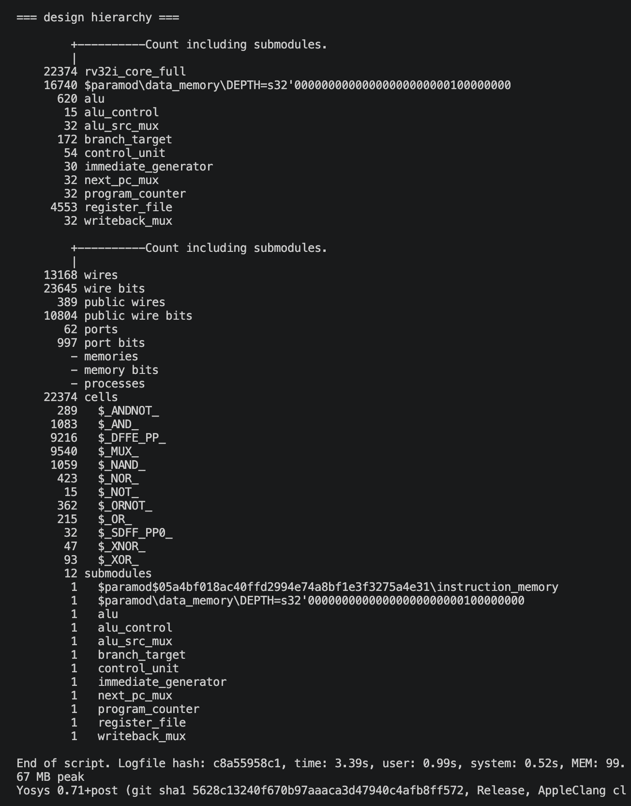

# Synthesis statistics

Generic synthesis of the full 10-instruction core (`rv32i_core_full`) with
Yosys (`synth -top rv32i_core_full`). These numbers are reproducible with:

```bash
yosys -p "read_verilog rtl/*.v; hierarchy -top rv32i_core_full; \
          synth -top rv32i_core_full; stat"
```



## Design summary

| Metric | Value |
|---|---|
| Top module | `rv32i_core_full` |
| Total cells (incl. submodules) | 22374 |
| Flip-flops (sequential state) | 9248 |
| Wires / wire bits | 13168 / 23645 |
| Ports / port bits | 62 / 997 |
| Clocks per instruction (CPI) | 1 (single-cycle) |

## Sequential state (flip-flops)

| Module | Flip-flops | Cell type |
|---|---|---|
| data_memory (256 x 32) | 8192 | `$_DFFE_PP_` |
| register_file (32 x 32) | 1024 | `$_DFFE_PP_` |
| program_counter (32-bit) | 32 | `$_SDFF_PP0_` |
| **Total** | **9248** | |

Note: the register file and data memory are modelled as asynchronous-read
arrays, so generic synthesis maps each storage bit to a flip-flop rather than
inferring a RAM macro. On an FPGA or ASIC flow these would map to block RAM or
a compiled memory, so 9248 is an upper bound on sequential resources, not a
silicon gate count.

## Cell usage by module (cells incl. submodules)

| Module | Cells |
|---|---|
| rv32i_core_full (top) | 22374 |
| data_memory | 16740 |
| register_file | 4553 |
| alu | 620 |
| branch_target | 172 |
| control_unit | 54 |
| alu_src_mux | 32 |
| next_pc_mux | 32 |
| program_counter | 32 |
| writeback_mux | 32 |
| immediate_generator | 30 |
| alu_control | 15 |

## Cell-type breakdown (top module)

| Cell type | Count | Role |
|---|---|---|
| `$_DFFE_PP_` | 9216 | Register-file and data-memory storage bits |
| `$_SDFF_PP0_` | 32 | Program-counter bits (synchronous reset) |
| `$_MUX_` | 9540 | Read-port, writeback, operand and next-PC selection |
| `$_AND_` | 1083 | Combinational logic |
| `$_NAND_` | 1059 | Combinational logic |
| `$_NOR_` | 423 | Combinational logic |
| `$_ORNOT_` | 362 | Combinational logic |
| `$_ANDNOT_` | 289 | Combinational logic |
| `$_OR_` | 215 | Combinational logic |
| `$_XOR_` | 93 | ALU arithmetic / XOR |
| `$_XNOR_` | 47 | Combinational logic |
| `$_NOT_` | 15 | Combinational logic |
| **Total** | **22374** | |

Synthesis completes with no inferred latches; all state is in explicit,
clock-edge flip-flops. The single-cycle organisation gives a fixed CPI of 1.
