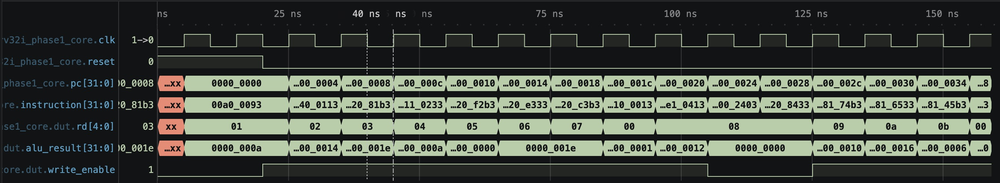

# Phase 1 waveform evidence

Each image is a screenshot of a VCD opened in VS Code with VaporView 1.6.1.
Icarus Verilog 13.0 generated the VCDs from the Phase 1 RTL and testbenches at
[`21ec7a2`](https://github.com/roboayushh/RISC-V/commit/21ec7a24be7e641681fd5386df8efe91a6a33871).
The screenshots are cropped to the viewer to remove editor chrome and local
paths. Signal values, markers and time axes come from VaporView.

## Reproduce the evidence

From the repository root, run the five suites:

```bash
bash scripts/run_fetch_tests.sh &&
bash scripts/run_storage_tests.sh &&
bash scripts/run_alu_tests.sh &&
bash scripts/run_saumya_tests.sh &&
bash scripts/run_phase1_tests.sh
```

The 15 simulations must pass before inspecting the corresponding files under
`build/`. Open a `tb_*.vcd` in VS Code with VaporView and add the signals
listed at left in the screenshot. Expand the `dut` scope for internal signals.
Open each image separately for full resolution.

## Integrated arithmetic demo




At 40 ns, PC is 0x08, rd is x3, the ALU output is 0x1E and write enable is high. The rising edge at 45 ns commits the ADD; the PC then selects SUB.

The self-checking testbench reads back `x3 = 30` after that edge.

## All 15 testbenches

| Suite | Testbench screenshot | What to look for |
|---|---|---|
| [`run_fetch_tests.sh`](../../scripts/run_fetch_tests.sh) | [Program counter](tb_program_counter.jpg) | The synchronous reset and explicit next-PC input drive the registered PC, including a redirect to 0x100. |
| [`run_fetch_tests.sh`](../../scripts/run_fetch_tests.sh) | [Instruction memory](tb_instruction_memory.jpg) | Aligned byte addresses fetch the expected words; invalid or uninitialized locations return the canonical NOP, 0x00000013. |
| [`run_fetch_tests.sh`](../../scripts/run_fetch_tests.sh) | [Integrated fetch path](tb_rv32i_core.jpg) | The PC advances by four bytes and selects the corresponding instruction at each step. |
| [`run_storage_tests.sh`](../../scripts/run_storage_tests.sh) | [Register file](tb_register_file.jpg) | Two asynchronous reads share the register array. The clocked write to x6 changes the read value from 0 to 0x4D at the rising edge. |
| [`run_storage_tests.sh`](../../scripts/run_storage_tests.sh) | [Data memory](tb_data_memory.jpg) | The test stores 0x19 at byte address 0x40, then reads it back. It also checks disabled reads and invalid addresses. |
| [`run_phase1_tests.sh`](../../scripts/run_phase1_tests.sh) | [One-word memory regression](tb_memory_depth_one.jpg) | Depth-one memories retain address 0 as the only valid word. The bench also checks disabled writes and out-of-range reads. |
| [`run_alu_tests.sh`](../../scripts/run_alu_tests.sh) | [Arithmetic logic unit](tb_alu.jpg) | Operation codes select ADD, SUB, AND, OR, or XOR. The waveform includes a zero result, with the zero flag asserted. |
| [`run_alu_tests.sh`](../../scripts/run_alu_tests.sh) | [ALU decoder](tb_alu_control.jpg) | The decoder uses ALUOp and function bits to select the operation. The unused operation code 7 represents unsupported combinations. |
| [`run_saumya_tests.sh`](../../scripts/run_saumya_tests.sh) | [Immediate generator](tb_immediate_generator.jpg) | ImmSrc selects I-, S-, and B-format sign extension. The vectors include signed limits and a reserved selector. |
| [`run_saumya_tests.sh`](../../scripts/run_saumya_tests.sh) | [ALU source multiplexer](tb_alu_src_mux.jpg) | ALUSrc selects either the second register operand or the sign-extended immediate for ALU operand B. |
| [`run_saumya_tests.sh`](../../scripts/run_saumya_tests.sh) | [Writeback multiplexer](tb_writeback_mux.jpg) | ResultSrc switches register writeback data between the ALU result and the memory read value. |
| [`run_saumya_tests.sh`](../../scripts/run_saumya_tests.sh) | [Next-PC multiplexer](tb_next_pc_mux.jpg) | PCSrc selects the sequential PC + 4 address or a supplied branch target. |
| [`run_saumya_tests.sh`](../../scripts/run_saumya_tests.sh) | [Branch target calculator](tb_branch_target.jpg) | The output adds the signed B offset to the current PC, including backward targets and 32-bit wraparound. |
| [`run_phase1_tests.sh`](../../scripts/run_phase1_tests.sh) | [Main control decoder](tb_control_unit.jpg) | The 20-vector bench checks arithmetic, the separate LW/SW and BEQ/BNE controls, and safe defaults. The ALU decoder and immediate generator are connected for interface checks. |
| [`run_phase1_tests.sh`](../../scripts/run_phase1_tests.sh) | [Integrated arithmetic datapath](tb_rv32i_phase1_core.jpg) | At 40 ns, PC is 0x08, rd is x3, the ALU output is 0x1E and write enable is high. The rising edge at 45 ns commits the ADD; the PC then selects SUB. |

See the [technical report](../phase1-report.pdf) for the datapath diagram,
control truth table, and annotated results. Phase 1 exercises loads, stores,
and branches in standalone modules and decoder tests. The integrated core
demo verifies arithmetic execution.
